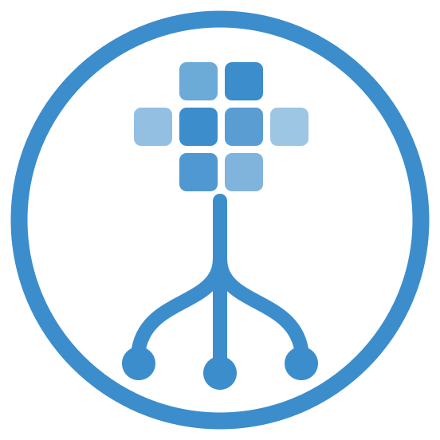
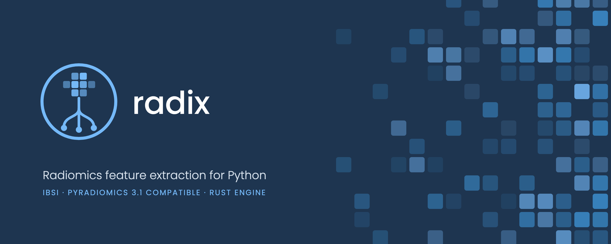
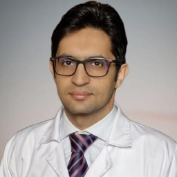

<p align="center"></p>
<h1 align="center">pyradix</h1>
<p align="center"><b>Fast, IBSI-compliant radiomics feature extraction for Python.<br>A PyRadiomics-compatible alternative with a Rust engine: standardised, reproducible and fast.</b></p>
<p align="center">
  <a href="https://pypi.org/project/pyradix-radiomics/"></a>
  <a href="https://pyradix.readthedocs.io"></a>
  <a href="https://github.com/ar1so/pyradix/actions/workflows/ci.yml"></a>
  
  
  <a href="LICENSE"></a>
  <a href="https://www.rust-lang.org"></a>
</p>



**pyradix** is an open-source Python library for **radiomics feature extraction** from CT, MRI and PET images. It computes IBSI-standardised shape, first-order and texture features (GLCM, GLRLM, GLSZM, GLDM, NGTDM), and it can also reproduce **PyRadiomics 3.1.0** results exactly.

## What does pyradix do?

You give it a medical image (CT, MRI, PET…) and a **mask** that marks a region in it, usually a tumour. It gives back a few hundred numbers, called **radiomics features**, that describe that region: its size and shape, how bright it is, and how its texture looks. Researchers put these numbers into statistics or machine learning, for example to predict how a tumour will respond to treatment.

```
  image.nii.gz ─┐
                ├─►  pyradix  ─►  original_shape_VoxelVolume   16412.66
  mask.nii.gz  ─┘                 original_firstorder_Mean       825.24
                                  original_glcm_Contrast          47.57
                                  … 108 features by default
```

What makes pyradix different:

- **Two standards in one package.** By default it follows **IBSI**, the Image Biomarker Standardisation Initiative, so your numbers mean the same as in other IBSI-compliant studies. With `mode="pyradiomics"` it gives the same numbers as **PyRadiomics 3.1.0**, the most widely used tool, so you can repeat or extend an older study, without installing PyRadiomics.
- **Checked against references.** Every change is tested against published IBSI values and against PyRadiomics 3.1.0, on Linux, macOS and Windows.
- **Fast.** The engine is written in Rust 🦀: typically 2–6× faster than PyRadiomics.
- **Reproducible.** Each result records every setting used, plus a fingerprint of them, so you can report exactly how the numbers were made.

> **Research software. Not intended for clinical use.**

---

**Contents:** [Install](#install) · [Your input files](#before-you-start-your-input-files) · [Quick start](#quick-start) · [Many patients](#many-patients--one-table) · [Which mode?](#which-mode-ibsi-or-pyradiomics) · [pyradix vs PyRadiomics](#pyradix-vs-pyradiomics) · [Migrating from PyRadiomics](#migrating-from-pyradiomics) · [More usage](#more-usage) · [What the features mean](#what-the-features-mean) · [Common errors](#common-errors) · [How we know it is right](#how-we-know-it-is-right) · [Speed](#speed) · [Limitations](#known-limitations) · [Roadmap](#roadmap-gpu-acceleration-planned) · [Help](#getting-help) · [Citing](#citing) · [About us](#about-us)

## Install

Ready-made packages exist for Python 3.10–3.13 on Linux, macOS and Windows, so you do not need Rust or a compiler. On PyPI the package is called **`pyradix-radiomics`**; in your code you still `import pyradix`.

**With pip:**

```bash
pip install pyradix-radiomics
```

**With [uv](https://docs.astral.sh/uv/):**

```bash
uv add pyradix-radiomics                     # add it to your project
uvx --from pyradix-radiomics pyradix --help  # or run the command line without installing
```

**With Docker** (no Python needed):

```bash
docker build -t pyradix https://github.com/ar1so/pyradix.git
docker run --rm -v "$PWD:/data" pyradix --help
```

**From source**, only if you want to change pyradix itself. You need Python 3.10–3.13 and Rust 1.85 or newer ([rustup.rs](https://rustup.rs)):

```bash
git clone https://github.com/ar1so/pyradix && cd pyradix
python -m pip install "maturin>=1.14,<1.16"
python -m maturin build --release -o dist
python -m pip install dist/*.whl
```

- **Linux:** first `sudo apt-get install pkg-config libopenblas-dev patchelf` (Debian/Ubuntu).
- **Windows:** first install the [Visual Studio C++ Build Tools](https://visualstudio.microsoft.com/visual-cpp-build-tools/) ("Desktop development with C++"). In PowerShell, replace the last line with `python -m pip install (Get-ChildItem dist\*.whl | Select-Object -First 1).FullName`.

**Check the install:**

```bash
pyradix --version
```

## Before you start: your input files

- **Formats:** NIfTI (`.nii`, `.nii.gz`) and NRRD (`.nrrd`). **DICOM is not read directly.** Convert a DICOM series to NIfTI first, for example with [dcm2niix](https://github.com/rordenlab/dcm2niix). Masks drawn as DICOM RTSTRUCT can be converted with tools such as [plastimatch](https://plastimatch.org) or [rt-utils](https://github.com/qurit/rt-utils).
- **The mask must line up with the image:** same number of voxels, same spacing, same position. A mask saved from the same scan usually does.
- **Labels:** the region is the voxels with value `1` in the mask. If your region uses another value, pass `label=…` (or `--label` on the command line).
- **CT** images should be in Hounsfield units, which is what converters produce.

## Quick start

**1. Get a sample case** (a brain MRI and its tumour mask, from the PyRadiomics project):

```bash
curl -LO https://raw.githubusercontent.com/AIM-Harvard/pyradiomics/master/data/brain1_image.nrrd
curl -LO https://raw.githubusercontent.com/AIM-Harvard/pyradiomics/master/data/brain1_label.nrrd
```

**2. Extract the features in Python:**

```python
from pyradix import RadixExtractor

result = RadixExtractor().extract("brain1_image.nrrd", "brain1_label.nrrd")

len(result.values)                            # 108
result.values["original_shape_VoxelVolume"]   # 16412.66   (mm³)
result.values["original_firstorder_Mean"]     # 825.24
result.provenance["mode"]                     # 'ibsi'
```

`result.values` is a dictionary: feature name → number. `result.provenance` holds the settings that were used.

**Or from the command line**, with no Python code:

```bash
pyradix extract brain1_image.nrrd brain1_label.nrrd --out features.csv
```

**Or with Docker**, from the folder that holds your files:

```bash
docker run --rm -v "$PWD:/data" pyradix extract brain1_image.nrrd brain1_label.nrrd --out features.csv
```

## Many patients → one table

Most studies need one row per patient. With your cases in folders like `cases/P001/image.nii.gz` and `cases/P001/mask.nii.gz`:

```python
from pathlib import Path
import pandas as pd                      # pip install pandas
from pyradix import RadixExtractor

extractor = RadixExtractor(mode="ibsi")
rows = []
for case in sorted(Path("cases").iterdir()):
    result = extractor.extract(case / "image.nii.gz", case / "mask.nii.gz")
    rows.append({"case": case.name, **result.values})

table = pd.DataFrame(rows).set_index("case")
table.to_csv("features.csv")             # one row per patient, one column per feature
```

## Which mode: IBSI or PyRadiomics?

| | `mode="ibsi"` (default) | `mode="pyradiomics"` |
|---|---|---|
| Follows | The IBSI standard (IBSI 1 features, IBSI 2 filters) | PyRadiomics 3.1.0 |
| Choose it when | You start a new study, or combine data from several centres | You must match numbers from a study that used PyRadiomics |
| Feature names | `original_glcm_Contrast` style | Exactly as in PyRadiomics |
| Image filters | Mean, LoG, Wavelet, Laws, Gabor | LoG, Wavelet, Square, Square Root, Logarithm, Exponential, Gradient, LBP |

**If unsure, use the default (`ibsi`).** The two standards define some things differently (for example where intensity bins start, and how a few statistics are computed), so the same image gives slightly different numbers in each mode. Never mix modes inside one study. Every difference is listed in [docs/DEVIATIONS.md](docs/DEVIATIONS.md).

## pyradix vs PyRadiomics

pyradix gives you the same feature classes, with the same names, from a different engine, and adds an IBSI mode.

| | pyradix | PyRadiomics 3.1.0 |
|---|---|---|
| Definitions followed | IBSI (default) **or** PyRadiomics 3.1.0 (`mode="pyradiomics"`) | PyRadiomics' own |
| Checked against IBSI 1 and IBSI 2 references | Yes, on every change ([how](#how-we-know-it-is-right)) | Partly; PyRadiomics documents where it differs from IBSI |
| Feature names | Same as PyRadiomics | — |
| PyRadiomics parameter files | Read unchanged (`from_pyradiomics_yaml`) | — |
| Engine | Rust; releases the Python GIL | Python with C extensions |
| Speed | Faster in `pyradiomics` mode ([see Speed](#speed)) | Reference |
| Ready-made wheels | Python 3.10–3.13 on Linux, macOS, Windows | See the PyRadiomics project |
| Reporting | Settings fingerprint and a CLEAR checklist YAML | `diagnostics_` fields |

## Migrating from PyRadiomics

Your parameter file and feature names carry over. Only the import and the call change: pyradix is not a drop-in `import radiomics` replacement.

```python
# Before: PyRadiomics
from radiomics import featureextractor
extractor = featureextractor.RadiomicsFeatureExtractor("params.yaml")
features = extractor.execute("image.nii.gz", "mask.nii.gz")

# After: pyradix, same numbers as PyRadiomics 3.1.0
from pyradix import RadixExtractor
extractor = RadixExtractor.from_pyradiomics_yaml("params.yaml")
features = extractor.extract("image.nii.gz", "mask.nii.gz").values
```

`from_pyradiomics_yaml` selects `mode="pyradiomics"` for you. For a new study, consider the IBSI default instead (see [Which mode?](#which-mode-ibsi-or-pyradiomics)).

## More usage

**Use an existing PyRadiomics parameter file** (unchanged):

```python
extractor = RadixExtractor.from_pyradiomics_yaml("params.yaml")
result = extractor.extract("image.nii.gz", "mask.nii.gz")
```

**Choose settings and features in code:**

```python
from pyradix import Params, RadixExtractor

params = Params(
    mode="pyradiomics",
    bin_width=25.0,                                   # intensity bin size
    label=1,
    feature_classes={"glcm": ["Contrast", "MCC"]},    # [] means "all features of this class"
)
result = RadixExtractor(mode="pyradiomics", params=params).extract("image.nii.gz", "mask.nii.gz")
```

**Write a report for your methods section.** [CLEAR](https://doi.org/10.1186/s13244-023-01415-8) is a reporting checklist for radiomics studies. pyradix writes the extraction part of it for you:

```python
from pyradix import dump_clear_yaml

dump_clear_yaml(result, "radiomics_report.yaml")   # software, version, mode, discretisation, resampling, filters
```

**Feature maps.** Instead of one number for the whole region, compute a feature around every voxel and get an image back:

```python
from pyradix import extract_voxel_maps, load_volume

image, mask = load_volume("image.nii.gz"), load_volume("mask.nii.gz")
maps = extract_voxel_maps(
    image.array, mask.array,
    mode="pyradiomics", kernel_radius=1, spacing=image.spacing,
    features=("Mean", "Entropy"),
)
maps["original_firstorder_Mean"]   # a 3D array, same shape as the image
```

More examples: [docsite/usage.md](docsite/usage.md).

## What the features mean

Feature names read `<image>_<class>_<feature>`, for example `original_glcm_Contrast`: computed on the original (unfiltered) image, class GLCM, feature Contrast.

| Class | In plain words |
|---|---|
| **First order** | Statistics of the intensities inside the region: mean, median, range, skewness, entropy… |
| **Shape** (2D, 3D) | Size and form of the region: volume, surface area, sphericity, longest diameter… |
| **GLCM** (grey-level co-occurrence matrix) | How often two intensity levels sit next to each other |
| **GLRLM** (grey-level run-length matrix) | How long straight runs of the same intensity are |
| **GLSZM** (grey-level size-zone matrix) | How large connected patches of the same intensity are |
| **GLDM** (grey-level dependence matrix) | How many neighbours have nearly the same intensity as each voxel |
| **NGTDM** (neighbouring grey-tone difference matrix) | How much each voxel differs from its neighbours on average |

Every feature, with its formula reference: [docs/FEATURES.md](docs/FEATURES.md).

## Common errors

| Message | What it means | What to do |
|---|---|---|
| `mask: label 2 is not in the mask; present labels: [1]` | Your region has a different value than the one asked for | Use one of the listed labels: `label=1` |
| `mask: image and mask geometry disagree …` | The mask does not line up with the image (size, spacing or position) | Use the mask saved from the same scan, or resample the mask onto the image grid |
| `unsupported image format: …` | The file is DICOM or another format | Convert to NIfTI first ([dcm2niix](https://github.com/rordenlab/dcm2niix)) |
| `… voxel(s) inside the ROI are NaN or infinite …` | Some image values inside the region are missing | Fill them or remove them from the mask |
| `ROI has 0 dimension(s), minimumROIDimensions is 2 …` | The region is a single voxel or a line | Check the mask; a region needs at least a small area |

## How we know it is right

Every push runs the test suite on Linux, macOS and Windows against public reference data:

| Check | Data | Result |
|---|---|---|
| IBSI 1 features | IBSI digital phantom (a small synthetic test image) and IBSI lung CT case "PAT1" | Match the values published by IBSI |
| IBSI 2 filters | IBSI 2 digital phantoms | Match the IBSI 2 reference responses |
| PyRadiomics 3.1.0 | "brain1" (MRI sample from PyRadiomics), IBSI phantom and lung CT | 107 of 107 default features match |
| PyRadiomics 3.1.0 with filters | brain1 and lung CT, with LoG and all 8 wavelet bands | 1,209 of 1,209 features match |
| PyRadiomics 3.1.0 with resampling | brain1 and lung CT at 1, 2 and 3 mm and uneven spacings | All match, except a few wavelet values on the lung CT at 3 mm (see limitations) |

"Match" means whole-number features are identical and all others agree to within 0.01% (or 0.0001 for values near zero). Details: [docs/VALIDATION.md](docs/VALIDATION.md). To run the checks yourself, see [CONTRIBUTING.md](CONTRIBUTING.md).

## Speed

Time to extract one case, after loading, with the same settings in both tools, on an Apple-silicon laptop:

| Case | Region size | pyradix | PyRadiomics 3.1.0 |
|---|---|---|---|
| brain1 MRI | 4,137 voxels | 0.07 s | 0.19 s |
| brain1 MRI, fine bins (`binWidth` 5) | 4,137 voxels | 0.17 s | 0.86 s |
| IBSI lung CT, whole mask | 125,256 voxels | 0.18 s | 1.1–1.3 s |

## Known limitations

- **One large check still to repeat.** In a September 2026 comparison on 421 lung tumours, two shape features (`Sphericity`, `SurfaceVolumeRatio`) differed slightly from PyRadiomics. The cause has been fixed and the features now match on every test case, but that full 421-tumour comparison has not been re-run yet.
- **Wavelet features after strong resampling.** When images are resampled to 3 mm or coarser, a handful of wavelet features can differ from PyRadiomics in the fourth significant digit.
- **DICOM** is not read directly; convert to NIfTI first.

## Roadmap: GPU acceleration (planned)

> **Planned — not yet available.** pyradix runs on the CPU today. Nothing below is in a release yet, and we will publish speed numbers only once they are measured.

We plan to add optional GPU backends so large studies (thousands of patients, many filters) extract in minutes rather than hours:

- **CUDA backend** for NVIDIA GPUs, and an **Apple Metal** backend for Apple-silicon Macs.
- **Batch extraction** across many patients and regions of interest in one call.
- **GPU texture matrices:** GLCM, GLRLM, GLSZM, GLDM and NGTDM computed on the GPU, together with image filters and voxel-wise feature maps.
- **Optional PyTorch tensor input and output**, so features can be computed inside a deep-learning pipeline without copying data back to the CPU.
- **Same numbers as the CPU path.** GPU results must pass the same IBSI 1, IBSI 2 and PyRadiomics 3.1.0 tests before release, and the CPU engine stays the reference.

The GPU backend will be an optional extra; the default install will not change. Ideas, use cases or hardware to test on: open an [issue](https://github.com/ar1so/pyradix/issues). Details: [Roadmap](https://pyradix.readthedocs.io/en/latest/roadmap/).

## Documentation

| | |
|---|---|
| [docs/FEATURES.md](docs/FEATURES.md) | Every feature and its definition |
| [docs/DEVIATIONS.md](docs/DEVIATIONS.md) | Where IBSI and PyRadiomics differ, and what each mode does |
| [docs/PREPROCESS.md](docs/PREPROCESS.md) | Resampling, re-segmentation and intensity binning |
| [docs/VALIDATION.md](docs/VALIDATION.md) | Test data, checks and tolerances |
| [pyradix.readthedocs.io](https://pyradix.readthedocs.io) | Full documentation: parameters, filters, every feature with its formula, FAQ, API reference |

## Getting help

Questions, wrong values or install problems: open an [issue](https://github.com/ar1so/pyradix/issues). The **Bug report** form asks for what we need to reproduce it, including `pyradix --version`.

## Contributing

Contributions are welcome, including new **modes**: named, validated ways to extract features for a modality or protocol. [CONTRIBUTING.md](CONTRIBUTING.md) explains how to propose one and exactly how it must be validated and tested.

## Citing

If you use pyradix in a publication, please cite it. The **Cite this repository** button on GitHub (from [CITATION.cff](CITATION.cff)) gives BibTeX and APA. If you used `mode="pyradiomics"`, also cite PyRadiomics (van Griethuysen et al., *Cancer Research* 2017); for `mode="ibsi"`, the IBSI reference manual (Zwanenburg et al., *Radiology* 2020).

## About us

<table>
<tr>
<td align="center" valign="top" width="25%"><br><b>Ahmadreza Sohrabi</b><br><sub>MD · <a href="https://github.com/ar1so">@ar1so</a></sub><br><br><div align="left"><sub>Ahmadreza discovered in medical school how much technology could change healthcare, and he has been building that change ever since. He’s Tech Lead at Zeenome and an AI Research Fellow at ADIR, developing deep learning for medical imaging. He also contributes to open-source medical AI and mentors young developer-researchers, guided by a belief in thoughtful, ethical AI.</sub></div><br><a href="https://www.linkedin.com/in/arsohrabi/"></a> <a href="https://github.com/ar1so"></a> <a href="https://scholar.google.com/citations?user=fLVfLUQAAAAJ&amp;hl=en"></a></td>
<td align="center" valign="top" width="25%"><br><b>Dr Shahriar Kolahi</b><br><sub>MD, EDiNR · <a href="https://github.com/shahriarkolahi-web">@shahriarkolahi-web</a></sub><br><br><div align="left"><sub>Shahriar is an Assistant Professor of Radiology at Tehran University of Medical Sciences and holds the European Diploma in Neuroradiology (EDiNR).</sub></div><br><a href="https://github.com/shahriarkolahi-web"></a></td>
<td align="center" valign="top" width="25%"><br><b>Amir Asef Agah</b><br><sub>MD · <a href="https://github.com/AmirAsefAgah">@AmirAsefAgah</a></sub><br><br><div align="left"><sub>Amir is a physician on the path to neurosurgery, driven by one question: how can imaging help surgeons make better decisions? As a Postdoctoral Research Fellow at ADIR, Tehran University of Medical Sciences, he works on MRI radiomics, cerebrovascular imaging, and automated segmentation. He also reviews for World Neurosurgery and JIIM.</sub></div><br><a href="https://www.linkedin.com/in/seyed-amir-asef-agah-552264180/"></a> <a href="https://github.com/AmirAsefAgah"></a> <a href="https://scholar.google.com/citations?user=Y0ZYG38AAAAJ&amp;hl=en"></a></td>
<td align="center" valign="top" width="25%"><br><b>Mostafa Neshat</b><br><sub>MD · <a href="https://github.com/mostafansh">@mostafansh</a></sub><br><br><div align="left"><sub>Mostafa sees a brain scan as both a patient’s story and data waiting to be understood. A physician at ADIR, he turns clinical neuroimaging into data AI models can learn from, and in 2025 he began an MSc in computer science. He’s on his way to radiology, hoping to make it more computational and quantitative.</sub></div><br><a href="https://www.linkedin.com/in/mostafansh/"></a> <a href="https://github.com/mostafansh"></a> <a href="https://scholar.google.com/citations?hl=en&amp;user=xIceI6AAAAAJ"></a></td>
</tr>
</table>

## License

[BSD 3-Clause](LICENSE).
